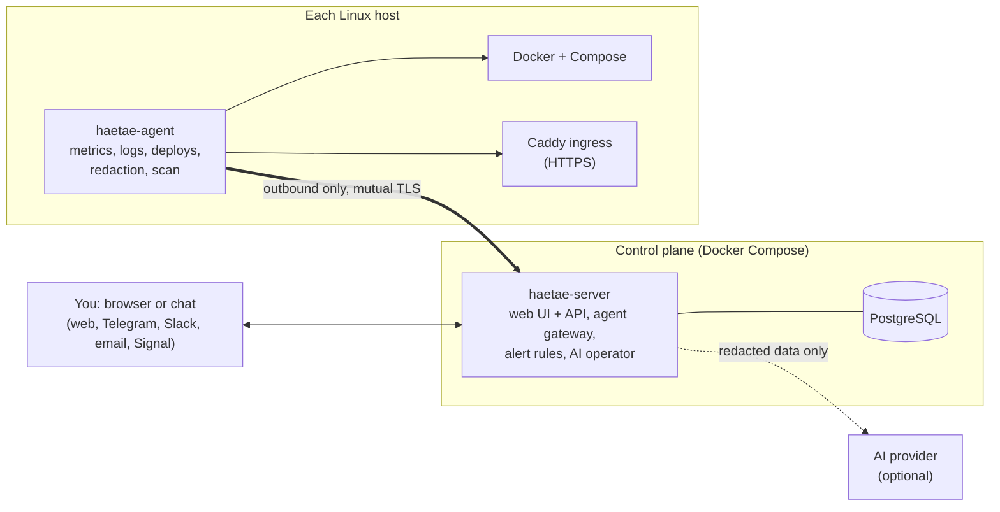

# Haetae

**An AI operator for Docker Compose servers: deploy, monitor, scan and get answers in chat, from one self-hosted tool.**

[](https://github.com/alexseymer/haetae/actions/workflows/ci.yml)
[](LICENSE)
[](go.mod)

> Haetae is a working name, pending trademark clearance. Status: v1 is built and verified in a single-VM environment; see [what you can and cannot trust](#what-you-can-and-cannot-trust).

## What is it

Haetae is for solo developers and small teams (2 to 10 people, 2 to 20 Linux servers) who run Docker Compose without Kubernetes or an ops person, and who today glue together a deploy tool, a monitoring stack and a scanner.

- **The problem:** running servers takes more attention than your product deserves.
- **The promise:** a small agent on each server, one control plane you run with Docker Compose, and a chat that tells you what happened and why, with a link to the evidence behind every statement. If the data shows no cause, it says "cause not found".
- **Free and self-hosted** under AGPL-3.0, every feature included, no data sent to us. A hosted service is planned, not built.

<!-- screenshots:start -->
<!--
Screenshots are added later in docs/images/. When they exist, replace this
comment block with an image gallery that links exactly these files:

  docs/images/hosts.png          Hosts list
  docs/images/host-overview.png  Host overview with metrics
  docs/images/incident.png       An incident with evidence
  docs/images/chat.png           Web chat with the operator
  docs/images/security.png       Security tab of a host
  docs/images/ai-operator.png    Settings, AI operator
  docs/images/add-host.png       Add host dialog with the enrollment command
-->
<!-- screenshots:end -->

## How it works



1. You run the **server** (plus PostgreSQL) with one installer command. It has its own certificate authority.
2. You enroll a **host** with a single-use token. The agent connects **outbound** to the server's gateway port with mutual TLS; it opens no listening port. It reconnects by itself.
3. The agent reads Docker state, metrics and logs, filters and redacts them **on the host**, and sends them over that connection. Commands (deploy, scan) come back the same way.
4. The server stores data in PostgreSQL, evaluates alert rules without any AI, and delivers messages to your chat channels.
5. The **AI operator** is optional. It answers questions from your own data, cites evidence, and only proposes or performs a restart if you allow it. Non-local providers only ever see redacted data.
6. Apps you deploy get HTTPS through a **Caddy** container the agent manages on that host.

More detail for contributors: [docs/architecture.md](docs/architecture.md).

## Quick start

There is **no published container image yet**, so you build it from this repository.

**Prerequisites:** a Linux host with Docker and Compose v2 (`docker compose version`), `git`, and `curl`; free TCP ports 8080 and 8443; root or `sudo` (the installer writes `/opt/haetae`). Hosts you manage need Docker and must reach both ports. One machine can be both for a trial.

**1. Build the server image and install** (clone anywhere except `/opt/haetae`):

```sh
git clone https://github.com/alexseymer/haetae.git haetae-src
cd haetae-src
docker build -t haetae-server:local .
sudo HAETAE_IMAGE=haetae-server:local HAETAE_NO_PULL=1 sh deploy/install-server.sh
```

The build includes the web UI and takes several minutes the first time. The installer prints a URL such as `https://203.0.113.10:8080` and a one-time setup code. If your managed hosts cannot reach that address, set `HAETAE_HOST=<name or IP they can reach>` as well. Options: [docs/install.md](docs/install.md).

**2. First login.** Open the URL (the browser warns about the certificate, which comes from the server's own CA). Enter the setup code, then the organisation name, email and password of the first administrator.

**3. Add a host.** **Hosts**, **Add host**, enter a name and validity, **Create token**. Run the shown command on the host as root. The host appears as **Online**, normally within seconds. Details: [docs/enroll.md](docs/enroll.md).

**4. Deploy the example.** Open the host, **Deploy** tab, **New project**. Name `hello`, source **Pasted compose file**, paste [examples/hello/compose.yaml](examples/hello/compose.yaml), leave the domain empty, **Create project**, then **Deploy now**. When it is **Healthy**, open `http://<host address>:8088/`. Steps, Git source and HTTPS: [examples/hello/README.md](examples/hello/README.md), [docs/deploy.md](docs/deploy.md).

**5. Optional:** connect a chat channel ([docs/chat.md](docs/chat.md)) and the AI operator ([docs/ai-operator.md](docs/ai-operator.md)). A published image (`ghcr.io/alexseymer/haetae-server`, the installer's default) is planned; until then keep the `HAETAE_IMAGE` and `HAETAE_NO_PULL` settings above.

## What you get

| You get | In plain words | Docs |
|---|---|---|
| **Servers and stacks** | Status, versions, ports, restarts, and CPU, memory, disk and network metrics, on by default. | [enroll](docs/enroll.md) |
| **Deploys** | From a Git repo or a pasted `compose.yaml`; build log, HTTPS via managed Caddy, one-click rollback; a failed deploy keeps the previous version running. | [deploy](docs/deploy.md) |
| **Push to deploy** | By polling the branch every 10 s from the agent; no webhook, no inbound port. | [deploy](docs/deploy.md) |
| **Alerts and briefing** | Rule-based incident alerts and one short daily briefing, working even when the AI is down. | [chat](docs/chat.md) |
| **Answers in chat** | Plain-language questions, each statement linked to evidence; "cause not found" otherwise. Needs a provider you configure. | [ai-operator](docs/ai-operator.md) |
| **Security per container** | Installed software, CVE with severity and fixed version, misconfigurations, outbound connections, image update policy. A failed scan says "scan failed", never "no vulnerabilities". | [security](docs/security.md) |
| **Safe by design** | Secrets and personal data are redacted on the host before a non-local AI sees anything; if redaction fails, nothing is sent. The operator never deletes data. | [ai-operator](docs/ai-operator.md) |

Out of scope for v1: Kubernetes, Swarm, buildpacks, preview deployments, running backups, SAML/SCIM, mobile apps ([spec](docs/spec.md)).

## What you can and cannot trust

Everything below comes from [docs/acceptance.md](docs/acceptance.md), run on one VM (2 cores, 8 GB) with `scripts/acceptance.sh`.

| Measured (loopback, hosts as containers on one machine) | Value |
|---|---|
| Enrollment to online | 116 ms |
| Host metrics visible | 10.1 s |
| Push to healthy, cached build | 6.1 s |
| Crash loop alert in web chat after the alert fired | 6 ms |
| Agent RSS peak, 20 noisy containers | 29.1 MiB (limit 50 MiB) |
| Redaction recall on the labelled corpus | secrets 1.000, personal data 1.000 |
| Install to login (image already built) | 31.4 s |

**Verified only against fakes or not at all:**

- **No run with a live AI provider.** Answer quality with a real model is unmeasured; the provider was scripted, and the wire formats were tested against test servers.
- Telegram ran against a fake Bot API; Slack, Signal and email are covered by unit tests only.
- Public certificate issuance (Let's Encrypt) was not run.
- Timings are loopback timings, not WAN or a real fleet. Only amd64 binaries were executed.
- No published image, no multi-arch image, no signing. The hosted service is not built.
- Agent client certificates last one year and cannot yet be renewed.

## Documentation

Start at the [documentation index](docs/README.md).

| Document | Contents |
|---|---|
| [docs/install.md](docs/install.md) | Server install, ports, TLS, reverse proxy, backups, upgrade, uninstall |
| [docs/enroll.md](docs/enroll.md) | Enrolling hosts, what the agent installs, flags, removing a host |
| [docs/deploy.md](docs/deploy.md) | Deploys, push-to-deploy, domains and HTTPS, rollback |
| [docs/chat.md](docs/chat.md) | Chat channels, linking, briefing, alerts, mutes |
| [docs/ai-operator.md](docs/ai-operator.md) | Providers, redaction, autonomy, approvals, limits |
| [docs/security.md](docs/security.md) | Scanning, CVE matching, outbound watch, image updates |
| [docs/troubleshooting.md](docs/troubleshooting.md) | Symptom to check lists |
| [docs/acceptance.md](docs/acceptance.md) | Every spec criterion with its test and measured value |
| [docs/architecture.md](docs/architecture.md) | Components, data flows, trust model |
| [docs/spec.md](docs/spec.md), [docs/roadmap.md](docs/roadmap.md) | Scope and build plan |

## Status and roadmap

All roadmap steps (M0 to M9) are built. Next:

- A run against a **live AI provider** and real chat services.
- A **published container image** (and release signing).
- **Agent certificate renewal** (see known limits in [docs/acceptance.md](docs/acceptance.md)).
- A **hosted service**.
- After v1: a local decision model for log labeling and privacy filtering, then SAML/SCIM and optional backups ([spec](docs/spec.md)).

## Security

Please report vulnerabilities privately, not in public issues. See [SECURITY.md](SECURITY.md).

## Contributing

Issues and pull requests are welcome. Read [CONTRIBUTING.md](CONTRIBUTING.md) first, and follow the [Code of Conduct](CODE_OF_CONDUCT.md).

## License

[GNU Affero General Public License v3.0](LICENSE) (AGPL-3.0-only). Every feature is included in the self-hosted version.
