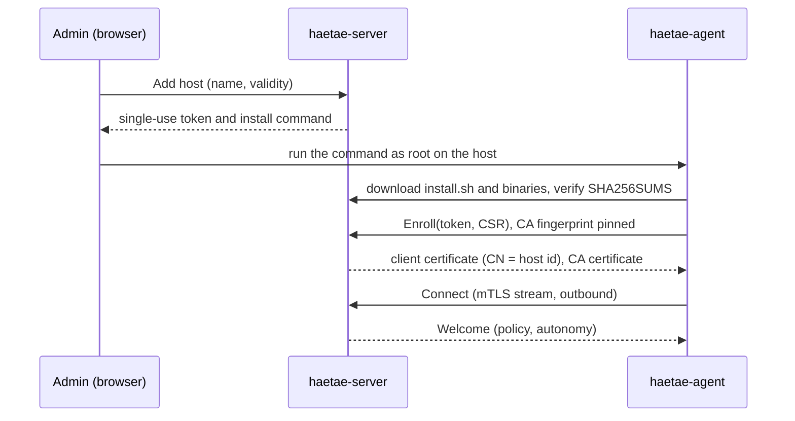
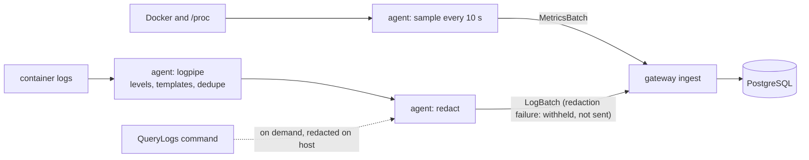
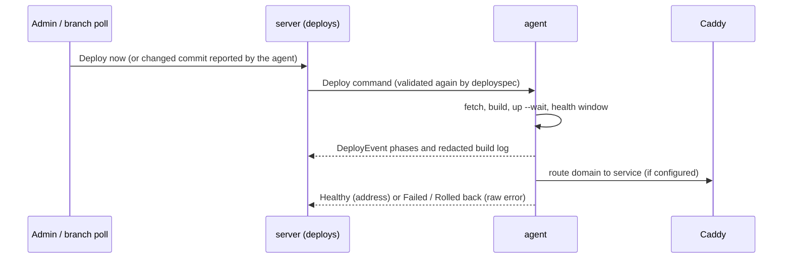
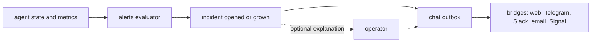
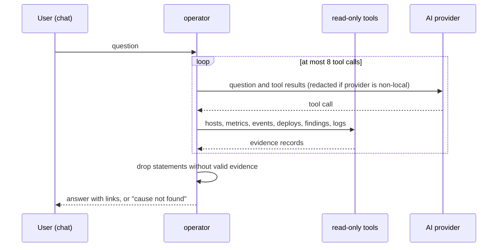
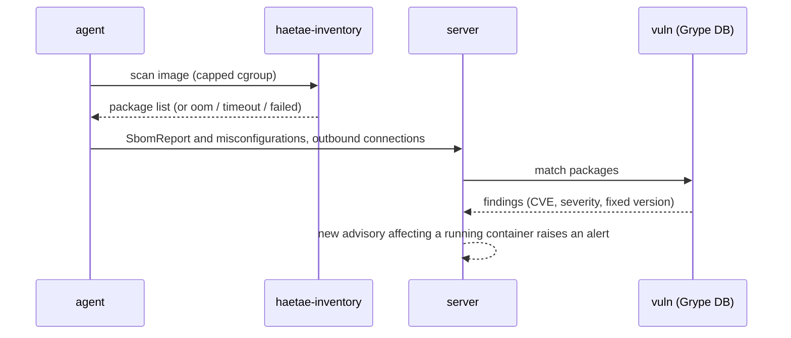

# Architecture

For contributors. Users should start at [README.md](../../README.md) and [docs/README.md](../README.md). The authoritative decisions are in [adr/0001-stack.md](adr/0001-stack.md) and the per-milestone designs in [design/](design/); this page is a map.

## Components

| Binary (`cmd/`) | Runs | Role |
|---|---|---|
| `haetae-server` | Control plane container | Web UI and API, agent gateway, rule engine, deploy orchestration, vulnerability matching, chat bridges, AI operator. State in PostgreSQL. |
| `haetae-agent` | Systemd service on each host | Enrolls once, then keeps one outbound mTLS stream open. Reads Docker state, metrics and logs; runs deploys; manages Caddy; runs scans. No listening port. |
| `haetae-inventory` | Child process of the agent | Short-lived Syft-based software inventory of one image, run in a memory-capped cgroup. |

## Packages (`internal/`)

| Package | One line |
|---|---|
| `agent` | Host agent: enrollment, stream client, state monitor, log pipeline wiring, command allowlist and autonomy policy |
| `agent/deploy` | Clone, build, `compose up`, health check, rollback, branch polling |
| `agent/ingress` | Manages the `haetae-caddy` container and routes domains to services |
| `agent/dockerapi`, `agent/hoststats` | Docker Engine access; host CPU, memory, disk and network sampling |
| `agent/scan` | Triggers and runs the inventory helper (cgroup launcher), daily rescan, reports |
| `agent/secfacts`, `agent/conntrack`, `agent/imagecheck` | Misconfigurations and certificates; outbound connections via conntrack; registry lookup for image updates |
| `alerts` | Rule engine, incidents, mutes; works without the AI |
| `api` | JSON API used by the web UI (accounts, hosts, deploys, alerts, chat, security) |
| `auth` | Password hashing, session tokens, login rate limiting |
| `briefing` | Daily briefing text and once-per-day scheduling |
| `chat` | Outbound delivery and inbound bridges: web, Telegram, Slack, email, Signal; account linking; button actions |
| `deployphase`, `deploys` | Deploy status transition table; when to start a deploy and talking to the agent |
| `deployspec` | Validation of deploy fields, shared by server and agent |
| `gateway` | Server side of the agent stream: ingest, log queries, deploy events, security reports, rate limits |
| `gen` | Generated protobuf and Connect code (from `proto/`) |
| `installer` | Serves the agent `install.sh` and release binaries |
| `inventory` | Builds the inventory JSON document |
| `logpipe` | Pure log core: levels, template aggregation, ring buffer, "judged green" set |
| `operator` | AI operator: tools, evidence, answer validation, action gating, usage cap; `provider/` holds the AI clients |
| `pki` | Internal certificate authority for agent mTLS |
| `redact` | Removes secrets and personal data (RE2 rules, time budget, fails closed) |
| `secrets` | Encrypts Git tokens at rest |
| `server` | Wires listeners, routes and background loops |
| `store` | PostgreSQL persistence, migrations (`store/migrations`), scoped transactions |
| `updates` | Image update policy (48 hour wait) |
| `vuln` | Grype database manager and SBOM matching |
| `version`, `webui`, `testutil` | Build metadata; embedded SPA; test helpers |

## Data flows

### Enrollment

### Metrics and logs

Metrics are rolled up with retention of 48 h at 10 s, 30 days at 1 min and 395 days at 1 h ([install.md](../getting-started/install-the-server.md)). The agent summarises routine log lines on the host; full raw logs stay in the agent's ring buffer and are fetched only on request, after redaction.

### Deploy

### Alert to chat

`alerts` does not import the operator or any AI package, and the operator does not import `alerts` (test-enforced). The alert goes out by rules first; an AI explanation, if any, follows ([design/m6-alerts-chat.md](design/m6-alerts-chat.md)).

### AI answer

### Security scan

A scan that does not finish is stored as "scan failed" with the reason, never as an empty result.

## Trust model

- **Agent identity.** The server runs its own CA ([pki](../../internal/pki/pki.go)). Enrollment tokens are single use and time limited; the agent pins the CA fingerprint. Each agent gets a client certificate whose common name is the host id; the gateway port needs that certificate (mutual TLS) and must not sit behind a TLS-terminating proxy. Removing a host revokes it. Certificates last one year and cannot yet be renewed.
- **Tenant isolation.** Tenant tables are scoped by organisation and protected by PostgreSQL Row-Level Security. Application code runs in scoped transactions that set `app.org_id` for the transaction (`internal/store/scoped.go`, `store/migrations/0005_row_level_security.sql`); a test covers every tenant table ([acceptance.md](acceptance.md)).
- **Redaction fails closed.** Redaction runs on the host with RE2 patterns under a time budget. If a chunk cannot be redacted, it is replaced by a withheld marker; with a non-local AI the server also sends nothing when redaction fails.
- **Autonomy is enforced twice.** The server decides what the operator may propose or perform from the organisation setting; each agent applies its own cap (`--max-autonomy`) and a fixed command allowlist. The operator's only action is `restart_container`; no command deletes data. Log text is treated as untrusted. Chat approvals are accepted only from linked, verified accounts.
- **Secrets at rest.** Git tokens are encrypted with a key in the server data directory ([secrets](../../internal/secrets/box.go)).

## Where to read next

- Stack decision: [adr/0001-stack.md](adr/0001-stack.md).
- Designs: [design/m5-deploys.md](design/m5-deploys.md), [design/m6-alerts-chat.md](design/m6-alerts-chat.md), [design/m7-security.md](design/m7-security.md), [design/m8-operator.md](design/m8-operator.md).
- Wire contract: `proto/haetae/agent/v1/agent.proto`.
- Scope and plan: [spec.md](spec.md), [roadmap.md](roadmap.md). Evidence: [acceptance.md](acceptance.md).
